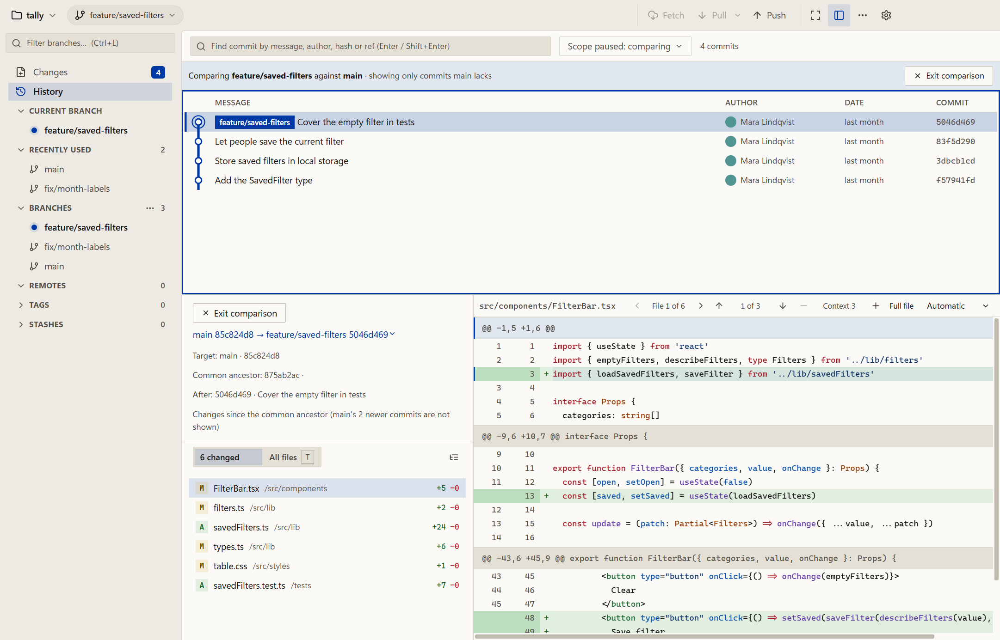

# Oak

A keyboard-friendly Git client for everyday Git with fewer distractions. Oak runs your installed Git, so your hooks, credentials, configuration and Git LFS work the way they do on the command line.

Windows 11 is the primary platform. Linux is experimental and macOS has not been tested. Features, screenshots and shortcuts are on the website: [www.benfourie.com/oak](https://www.benfourie.com/oak/).

<picture>
  <source media="(prefers-color-scheme: dark)" srcset="website/public/oak-comparison-dark.png">
  
</picture>

## Highlights

- A command palette (Ctrl+Shift+P) for branch, stash, diff, history and preference actions.
- Stage by file, hunk or single line.
- Compare a branch with its target without checking it out.
- File history, Blame and find in diffs.
- Navigate everything by keyboard, with optional h/j/k/l keys. Press Ctrl+/ in the app for every shortcut.

## Download

Get the Windows installer or the Linux x64 packages (Debian and AppImage) from [the latest release](https://github.com/benfo/oak/releases/latest). There are no macOS downloads yet.

- **Windows:** requires Git on your PATH. The installer is not code-signed yet, so Windows may block it. Right-click the file, choose Properties and tick Unblock, or run `Unblock-File .\Oak-Setup-<version>.exe` in PowerShell. In SmartScreen, choose More info, then Run anyway.
- **Ubuntu:** `sudo apt install ./Oak-<version>-linux-amd64.deb`. This also installs Git and the desktop dependencies.
- **AppImage:** install Git, mark the file as executable and open it.

## Contributing

Requires Node.js 24+, npm and Git on your PATH.

```sh
npm ci
npm run dev
```

Run `npm run typecheck`, `npm run lint` and `npm test` before opening a pull request. See [CONTRIBUTING.md](CONTRIBUTING.md) for the workflow, [AGENTS.md](AGENTS.md) for the conventions that apply to people and coding agents, and [ROADMAP.md](ROADMAP.md) for decisions and planned work. Issues and pull requests are welcome, and the maintainer reviews every change.

## License

Oak is licensed under the [MIT License](LICENSE).
